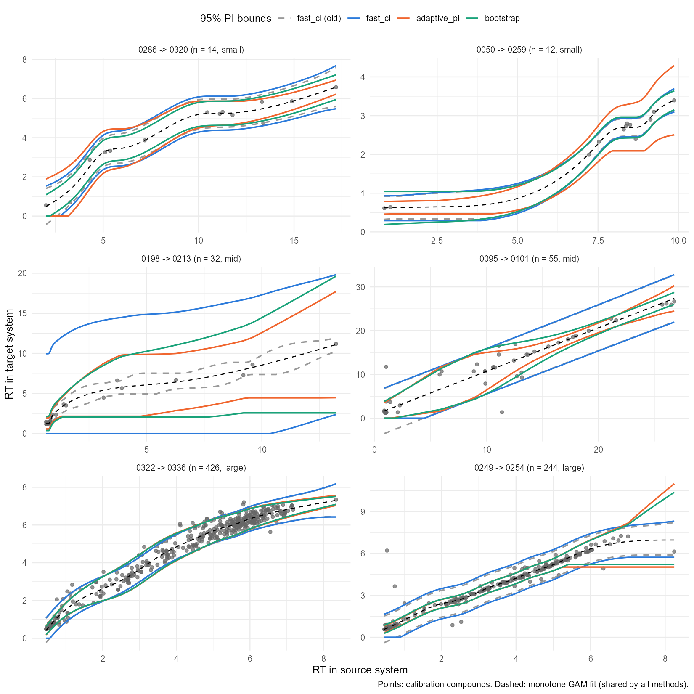

# Prediction Interval Benchmark

rePredRet offers three ways to compute the 95% prediction interval (PI)
around the monotone GAM (see
[Methods](https://stanstrup-metabolomics.github.io/rePredRet/articles/methods.md)):

| Method | Interval width | Calibration |
|----|----|----|
| `adaptive_pi` (default) | follows the local scatter | cross-validated conformal |
| `fast_ci` | nearly constant | normal quantile, leave-one-out residual variance |
| `bootstrap` | follows the local scatter | out-of-bag conformal (200 refits) |

This article compares them with each other, with the versions before
they were fixed, and with the alternatives suggested in an MSc thesis
evaluation (B. Hamidová, 2026): a weighted or MAD residual scale, a
heavy-tailed `scat` likelihood, quantile GAMs (`qgam`) and a
location-scale GAM (`gaulss`). That evaluation found the problems with
the earlier methods and gave the idea for `adaptive_pi`.

## Setup

- **Data**: RepoRT reversed-phase systems. Of the 49,570 ordered pairs
  with at least 10 shared compounds, one direction per pair was sampled
  at random: 40 pairs with 10-15 compounds, 40 with 30-60 and 30 with
  200 or more. Another 25 pairs were chosen for clearly unequal scatter
  along the model: the largest ratio of the median absolute residual
  between thirds of the RT range, among 600 random pairs with R² ≥ 0.8.
- **Coverage**: compounds were held out by cross-validation
  (leave-one-out up to 30 compounds, 10-fold up to 100, 5-fold above). A
  held-out compound is covered if its measured RT lies inside the PI of
  the model built without it.
- **Well-annotated compounds**: outliers are taken to be wrong
  annotations, which the model and its interval should ignore. A
  compound counts as well-annotated if its sigmoid outlier weight in the
  fit with all compounds is at least 0.5; this holds for 94.1% of the
  compounds. **Coverage** is the coverage of the well-annotated
  compounds, which should be 95%. The coverage of all compounds and of
  the outliers alone are shown for comparison.
- **Quiet / noisy**: each compound is labelled by the scatter of its
  neighbours along the source RT, split at the pair’s median. An
  interval whose width follows the scatter covers about 95% of the
  well-annotated compounds in both.
- **Interval score**: width + (2 / 0.05) × distance outside the
  interval, divided by the target RT range (median over pairs; lower is
  better). It rewards coverage and narrow intervals together.
- **Width ratio**: 95th / 5th percentile of the width along the model (1
  = constant).
- **Failures**: fits that errored or gave non-finite bounds. **Absurd**:
  median width larger than the target RT range.

The script is `inst/benchmark/pi_benchmark.R`.

## Results

| Method | Coverage | All compounds | Outliers | Quiet | Noisy | Interval score | Median width / range | Width ratio | Failures | Absurd |
|:---|---:|---:|---:|---:|---:|---:|---:|---:|---:|---:|
| adaptive_pi | 0.946 | 0.911 | 0.343 | 0.949 | 0.944 | 0.224 | 0.209 | 4.801 | 0 | 2 |
| fast_ci | 0.981 | 0.955 | 0.535 | 0.991 | 0.970 | 0.343 | 0.311 | 1.205 | 0 | 15 |
| bootstrap | 0.949 | 0.914 | 0.355 | 0.951 | 0.947 | 0.229 | 0.214 | 4.112 | 2 | 3 |
| fast_ci (before fix) | 0.971 | 0.941 | 0.459 | 0.985 | 0.956 | 0.309 | 0.249 | 1.150 | 0 | 10 |
| bootstrap (before fix) | 0.651 | 0.624 | 0.186 | 0.657 | 0.645 | 0.286 | 0.164 | 5.796 | 1 | 3 |
| weighted sigma | 0.937 | 0.889 | 0.129 | 0.971 | 0.899 | 0.235 | 0.165 | 1.387 | 0 | 1 |
| MAD sigma | 0.875 | 0.831 | 0.136 | 0.935 | 0.806 | 0.279 | 0.142 | 1.724 | 0 | 1 |
| scat | 0.957 | 0.925 | 0.419 | 0.981 | 0.930 | 0.268 | 0.235 | 1.509 | 0 | 4 |
| qgam | 0.983 | 0.965 | 0.687 | 0.985 | 0.980 | 0.429 | 0.325 | 1.610 | 21 | 14 |
| gaulss | 0.946 | 0.919 | 0.497 | 0.947 | 0.944 | 0.301 | 0.210 | 9.114 | 14 | 6 |

All 135 pairs (95% nominal coverage of the well-annotated compounds)

| Method | small (10-15) | mid (30-60) | large (200+) | heteroscedastic | heteroscedastic, noisy regions |
|:---|---:|---:|---:|---:|---:|
| adaptive_pi | 0.854 | 0.951 | 0.950 | 0.946 | 0.929 |
| fast_ci | 0.923 | 0.974 | 0.985 | 0.981 | 0.959 |
| bootstrap | 0.884 | 0.953 | 0.950 | 0.954 | 0.940 |
| fast_ci (before fix) | 0.857 | 0.949 | 0.981 | 0.966 | 0.927 |
| bootstrap (before fix) | 0.917 | 0.823 | 0.578 | 0.819 | 0.791 |
| weighted sigma | 0.846 | 0.917 | 0.946 | 0.930 | 0.856 |
| MAD sigma | 0.788 | 0.862 | 0.892 | 0.818 | 0.639 |
| scat | 0.909 | 0.949 | 0.964 | 0.944 | 0.886 |
| qgam | 0.849 | 0.973 | 0.989 | 0.991 | 0.981 |
| gaulss | 0.792 | 0.912 | 0.963 | 0.920 | 0.919 |

Coverage of the well-annotated compounds by group

- **`adaptive_pi`** covers 94.6% overall, and about the same in quiet
  and noisy regions (94.9% / 94.4%). Its width varies along the model
  (median ratio 4.8). It covers 34.3% of the outliers: it does not widen
  to include wrong annotations.
- **`fast_ci`** covers 98.1%, more than the nominal 95%, most of all in
  quiet regions (99.1% / 97.0%). Its nearly constant width has to be
  wide everywhere to hold where the compounds scatter: the median width
  is 31.1% of the target RT range, against 20.9% for `adaptive_pi`. Its
  variance also includes the outliers, which it covers more often
  (53.5%). Before the fix (in-sample residual variance and
  running-maximum bounds) it covered 97.1% overall and 85.7% with 10-15
  compounds.
- **`bootstrap`** behaves like `adaptive_pi` (94.9% coverage) at 25-50
  times the cost. Before the fix it was a confidence interval of the
  curve rather than a prediction interval (65.1% coverage).
- A **weighted** or **MAD** residual scale ignores the outliers too, but
  with a constant width and a normal quantile it undercovers (93.7% and
  87.5%), most of all in noisy regions. A robust scale needs an
  empirical calibration, as in `adaptive_pi`.
- **`scat`** keeps a constant width: too wide in quiet regions and too
  narrow in noisy ones (98.1% / 93.0%). **`qgam`** overcovers with wide
  intervals from 30 compounds up, failed 21 fits, mostly with 10-15
  compounds, and takes about 1.3 s per model. **`gaulss`** adapts the
  width but is unstable with few compounds (14 failures, very large
  width ratios).

### Few compounds

With 10-15 shared compounds no method reaches 95%: `adaptive_pi` covered
85.4%, `fast_ci` 92.3% and `bootstrap` 88.4%. Treat the intervals of
models with fewer than about 20 compounds as roughly 85-90% intervals.

## Examples

The bands of the three methods, and of `fast_ci` before the fix, on
pairs with unequal scatter. `adaptive_pi` and `bootstrap` are narrow
where the compounds agree, often in the early-eluting cluster, and wide
where they scatter. Where the raw bound would decrease, the monotone
bound is flat.

Pairs of different sizes:

## Speed

Single-core time to compute the interval, including the monotone fit, on
120 random pairs (bootstrap: 40 pairs). The last two columns extrapolate
to the about 50,000 models of the full pipeline.

| Method | Models | Mean ms | Median ms | Max ms | Hours, 50k models, 1 core | Hours, 50k models, 4 cores |
|:---|---:|---:|---:|---:|---:|---:|
| adaptive_pi | 120 | 54.3 | 50 | 330 | 0.75 | 0.19 |
| fast_ci | 120 | 15.7 | 20 | 40 | 0.22 | 0.05 |
| bootstrap | 40 | 1332.7 | 1275 | 3160 | 18.51 | 4.63 |
| fast_ci (old) | 120 | 10.5 | 10 | 140 | 0.15 | 0.04 |

Most of the time of `adaptive_pi` is the scale model (a Gamma GAM). Its
five cross-validation refits are cheap because they reuse the smoothing
parameter of the full fit.

## Conclusion

`adaptive_pi` is the default: it is calibrated in quiet and noisy
regions and costs about 50-90 ms per model. Use `fast_ci` when speed
matters more than an interval that follows the local scatter.
