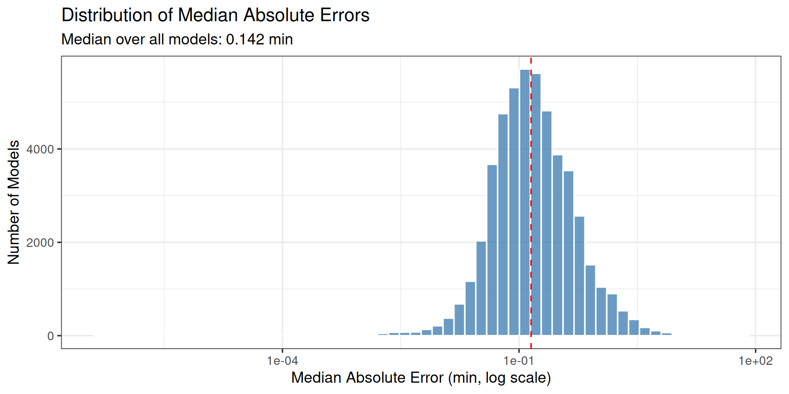
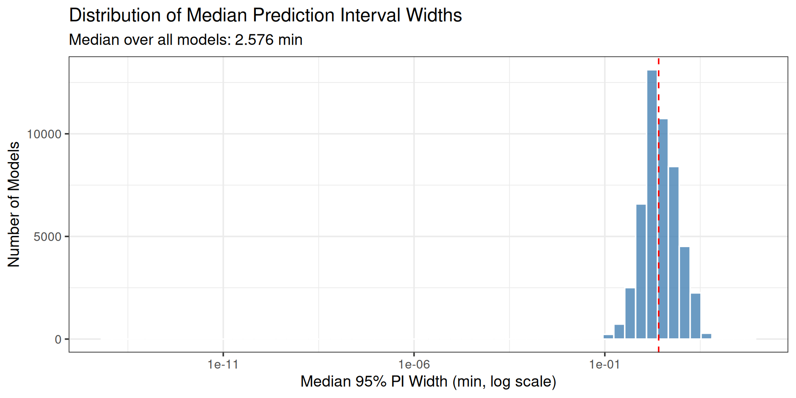
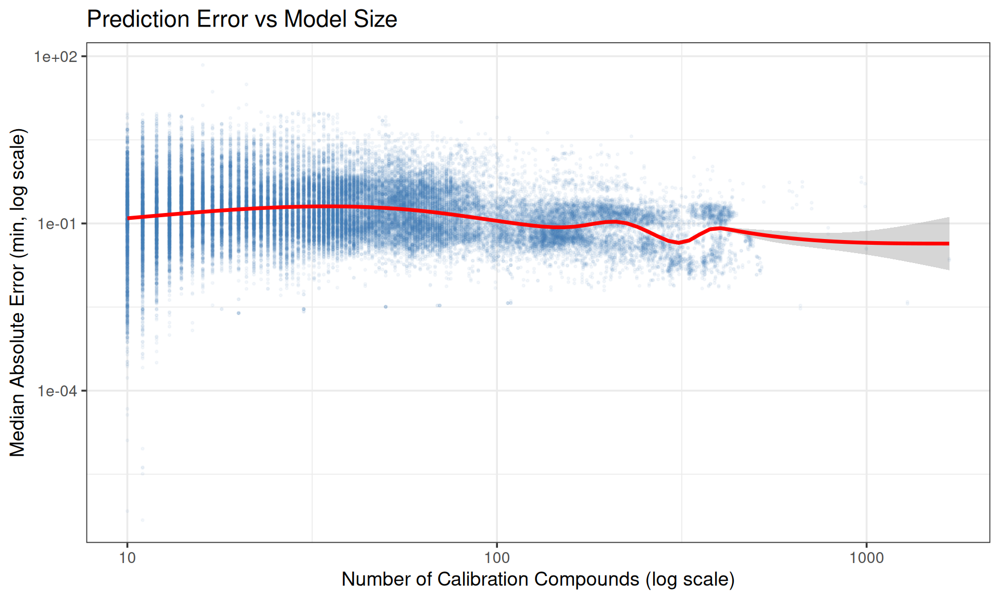
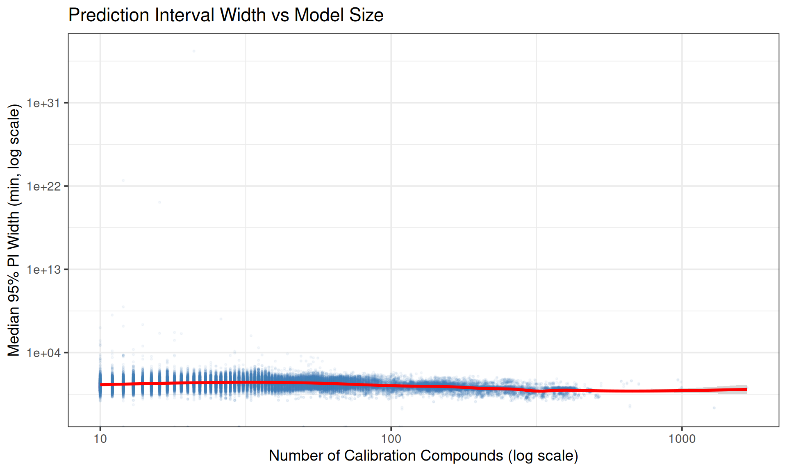

# Model Statistics

All statistics are per model, computed at the calibration compounds of
each model:

- **Median error**: median absolute difference between fitted and
  measured RT
- **Median PI width**: median width of the 95% prediction interval over
  the RT range

## Summary

| Statistic              |     Value |
|:-----------------------|----------:|
| Total Models           |    52,612 |
| Total Systems          |       399 |
| Calibration Points     | 3,458,980 |
| Median Compounds/Model |        37 |
| Median Error (min)     |     0.151 |
| Median PI Width (min)  |     2.178 |

## Error Distribution

## Prediction Interval Width Distribution

    Warning in scale_x_log10(breaks = log_breaks, labels = plain_labels, ...):
    log-10 transformation introduced infinite values.

    Warning: Removed 44 rows containing non-finite outside the scale range
    (`stat_bin()`).

## Model Quality vs Number of Compounds

    Warning in scale_y_log10(breaks = log_breaks, labels = plain_labels, ...): log-10 transformation introduced infinite values.
    log-10 transformation introduced infinite values.

    Warning: Removed 44 rows containing non-finite outside the scale range
    (`stat_smooth()`).

## Largest Models

| From | To   |    N | Error (min) | PI Width (min) |
|:-----|:-----|-----:|------------:|---------------:|
| 0382 | 0383 | 1673 |       0.023 |          1.237 |
| 0383 | 0382 | 1673 |       0.022 |          1.194 |
| 0382 | 0436 | 1290 |       0.004 |          0.010 |
| 0436 | 0382 | 1290 |       0.004 |          0.010 |
| 0383 | 0436 |  998 |       0.036 |          1.257 |
| 0436 | 0383 |  998 |       0.034 |          1.266 |
| 0186 | 0391 |  991 |       0.201 |          1.144 |
| 0391 | 0186 |  991 |       0.515 |          5.042 |
| 0225 | 0228 |  980 |       0.002 |          0.000 |
| 0228 | 0225 |  980 |       0.002 |          0.000 |
| 0262 | 0263 |  968 |       0.669 |          7.529 |
| 0263 | 0262 |  968 |       0.550 |          5.495 |
| 0063 | 0391 |  787 |       0.065 |          0.601 |
| 0391 | 0063 |  787 |       0.084 |          0.735 |
| 0262 | 0382 |  710 |       0.184 |          1.816 |
| 0382 | 0262 |  710 |       0.236 |          2.171 |
| 0263 | 0382 |  670 |       0.452 |          3.882 |
| 0382 | 0263 |  670 |       0.558 |          4.776 |
| 0219 | 0429 |  662 |       0.003 |          0.020 |
| 0429 | 0219 |  662 |       0.003 |          0.013 |
| 0262 | 0383 |  647 |       0.219 |          2.017 |
| 0383 | 0262 |  647 |       0.314 |          3.082 |
| 0382 | 0391 |  630 |       0.189 |          1.268 |
| 0391 | 0382 |  630 |       0.370 |          2.069 |
| 0263 | 0383 |  618 |       0.383 |          3.260 |
| 0383 | 0263 |  618 |       0.546 |          4.614 |
| 0383 | 0391 |  527 |       0.242 |          1.443 |
| 0391 | 0383 |  527 |       0.454 |          2.629 |
| 0244 | 0246 |  520 |       0.016 |          0.158 |
| 0246 | 0244 |  520 |       0.017 |          0.190 |
| 0236 | 0238 |  516 |       0.020 |          0.129 |
| 0238 | 0236 |  516 |       0.014 |          0.124 |
| 0246 | 0248 |  516 |       0.014 |          0.164 |
| 0248 | 0246 |  516 |       0.013 |          0.150 |
| 0238 | 0240 |  513 |       0.014 |          0.143 |
| 0240 | 0238 |  513 |       0.014 |          0.151 |
| 0252 | 0256 |  513 |       0.024 |          0.259 |
| 0256 | 0252 |  513 |       0.024 |          0.285 |
| 0244 | 0248 |  507 |       0.025 |          0.235 |
| 0248 | 0244 |  507 |       0.025 |          0.262 |
| 0252 | 0254 |  507 |       0.018 |          0.193 |
| 0254 | 0252 |  507 |       0.018 |          0.191 |
| 0236 | 0240 |  504 |       0.025 |          0.235 |
| 0240 | 0236 |  504 |       0.026 |          0.246 |
| 0254 | 0256 |  504 |       0.012 |          0.132 |
| 0256 | 0254 |  504 |       0.012 |          0.133 |
| 0238 | 0246 |  494 |       0.045 |          0.601 |
| 0246 | 0238 |  494 |       0.051 |          0.632 |
| 0238 | 0252 |  493 |       0.039 |          0.563 |
| 0252 | 0238 |  493 |       0.040 |          0.496 |
| 0238 | 0256 |  488 |       0.047 |          0.504 |
| 0256 | 0238 |  488 |       0.050 |          0.488 |
| 0246 | 0252 |  487 |       0.054 |          0.779 |
| 0252 | 0246 |  487 |       0.051 |          0.916 |
| 0236 | 0252 |  486 |       0.043 |          0.543 |
| 0246 | 0256 |  486 |       0.057 |          0.713 |
| 0252 | 0236 |  486 |       0.042 |          0.517 |
| 0256 | 0246 |  486 |       0.055 |          0.911 |
| 0238 | 0254 |  485 |       0.044 |          0.552 |
| 0240 | 0256 |  485 |       0.039 |          0.445 |
| 0246 | 0254 |  485 |       0.051 |          0.774 |
| 0254 | 0238 |  485 |       0.047 |          0.483 |
| 0254 | 0246 |  485 |       0.049 |          0.799 |
| 0256 | 0240 |  485 |       0.041 |          0.395 |
| 0240 | 0252 |  484 |       0.039 |          0.578 |
| 0252 | 0240 |  484 |       0.042 |          0.486 |
| 0244 | 0252 |  483 |       0.049 |          0.707 |
| 0252 | 0244 |  483 |       0.053 |          0.790 |
| 0236 | 0246 |  482 |       0.048 |          0.490 |
| 0240 | 0246 |  482 |       0.041 |          0.431 |
| 0246 | 0236 |  482 |       0.056 |          0.535 |
| 0246 | 0240 |  482 |       0.047 |          0.477 |
| 0236 | 0254 |  481 |       0.053 |          0.584 |
| 0236 | 0256 |  481 |       0.056 |          0.564 |
| 0254 | 0236 |  481 |       0.055 |          0.553 |
| 0256 | 0236 |  481 |       0.061 |          0.535 |
| 0238 | 0244 |  480 |       0.049 |          0.536 |
| 0244 | 0238 |  480 |       0.050 |          0.582 |
| 0402 | 0403 |  480 |       0.020 |          0.486 |
| 0403 | 0402 |  480 |       0.034 |          0.521 |
| 0244 | 0254 |  479 |       0.058 |          0.724 |
| 0254 | 0244 |  479 |       0.059 |          0.883 |
| 0244 | 0256 |  478 |       0.060 |          0.853 |
| 0248 | 0256 |  478 |       0.057 |          0.719 |
| 0256 | 0244 |  478 |       0.064 |          0.945 |
| 0256 | 0248 |  478 |       0.055 |          0.881 |
| 0240 | 0254 |  477 |       0.035 |          0.483 |
| 0254 | 0240 |  477 |       0.038 |          0.442 |
| 0238 | 0248 |  476 |       0.051 |          0.562 |
| 0248 | 0238 |  476 |       0.062 |          0.647 |
| 0248 | 0252 |  473 |       0.059 |          0.961 |
| 0252 | 0248 |  473 |       0.063 |          1.226 |
| 0248 | 0254 |  472 |       0.053 |          0.758 |
| 0254 | 0248 |  472 |       0.055 |          0.878 |
| 0236 | 0244 |  471 |       0.048 |          0.606 |
| 0240 | 0244 |  471 |       0.047 |          0.497 |
| 0244 | 0236 |  471 |       0.049 |          0.534 |
| 0244 | 0240 |  471 |       0.048 |          0.558 |
| 0236 | 0248 |  469 |       0.059 |          0.571 |
| 0240 | 0248 |  469 |       0.047 |          0.501 |

Top 100 models by number of calibration compounds
