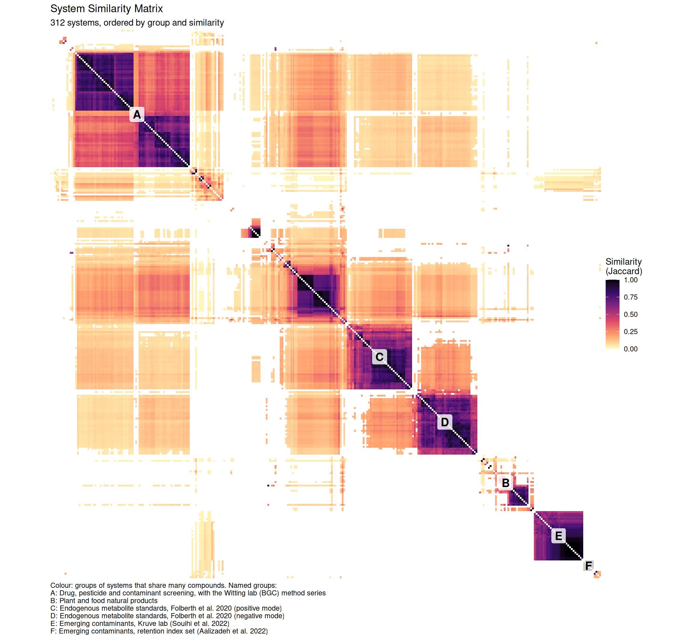

# System Network

## Network Overview

The network shows how chromatographic systems are connected through
pairwise models. Each node is a system and each edge a model between two
systems (models are directional: one per source/target pair). Models are
only built between systems of the same method type (reversed-phase with
reversed-phase, HILIC with HILIC), since the elution order differs
between the types.

| Metric                                |  Value |
|:--------------------------------------|-------:|
| Total Systems (Nodes)                 |    328 |
| Total Models (Edges)                  | 49,570 |
| Models between RP systems             | 49,570 |
| Average Models per System (as source) |  151.1 |
| Network Density                       | 46.22% |

## Network Visualization

Each point is a system, sized by its number of compounds; the shape
shows the method type. Hover over a system to see its name and group;
the letters of the named groups are explained in the table below the
plot.

How close two systems are is measured by their similarity: the Jaccard
index of their compounds, i.e. shared compounds divided by the compounds
in either system. Unlike the number of shared compounds, it does not
make every system look close to the few very large ones. The systems are
placed using only the links with a similarity of at least 0.4, so that
systems sharing most of their compounds end up together. All pairs
sharing at least 20 compounds are then drawn, wider and darker the more
similar they are, so weak links fade into the background. The slider
hides the links below a chosen similarity.

The colours are groups of systems that share many compounds, found from
all pairs. Dark bundles between groups are many pairs of systems in two
groups that share a fair part of their compounds.

The groups mostly reflect which lab submitted a series of systems
measured with the same set of standards; where a lab’s standards are
distinctive, the kind of compounds shows through. Six groups were named
by hand (see the table below). The groups are recomputed whenever the
data change, so a group gets a name only when it still matches the named
group: at least half of its systems belong to the named group, and at
least half of the named group’s systems are in it. Other groups are
shown as unnamed.

### Named Groups

The groups were named from the studies that contributed their systems
(titles from their DOIs) and the chemical classes (ClassyFire) of their
compounds, using the RepoRT data of October 2026. A further group of 69
systems, mostly metabolomics of human, plant and food samples from many
labs, could not be given a convincing name. The member lists are in
`inst/extdata/system_groups.csv`.

| Group | Name | Systems (Oct 2026) | Basis |
|:---|:---|---:|:---|
| A | Drug, pesticide and contaminant screening, with the Witting lab (BGC) method series | 102 | 67 systems are one Witting lab series (Dataset - BGC: the same ~850 standards, lipids, bile acids, metabolites and some pesticides, across columns, acetonitrile levels and MS modes); almost all others are screening of pharmaceuticals, drugs of abuse, pesticides and environmental contaminants, plus the METLIN SMRT library of synthetic molecules |
| B | Plant and food natural products | 33 | 21 systems from Data sharing in PredRet for accurate prediction of retention time: application to plant food bioactive compounds (Food Chem 2021); others from plant metabolomes, apple and honey phenolics, natural product dereplication and Chinese herbal medicine; compounds mainly terpenoids, flavonoids, alkaloids and coumarins |
| C | Endogenous metabolite standards, Folberth et al. 2020 (positive mode) | 37 | All from MS2 and LC libraries for untargeted metabolomics (J Chromatogr B 2020, doi:10.1016/j.jchromb.2020.122105): the same standards on 37 methods, positive ionisation |
| D | Endogenous metabolite standards, Folberth et al. 2020 (negative mode) | 37 | As C, negative ionisation |
| E | Emerging contaminants, Kruve lab (Souihi et al. 2022) | 28 | All from MultiConditionRT: predicting liquid chromatography retention time for emerging contaminants for a wide range of eluent conditions (J Chromatogr A 2022, doi:10.1016/j.chroma.2022.462867): one standard mix under 28 eluent conditions |
| F | Emerging contaminants, retention index set (Aalizadeh et al. 2022) | 6 | All from the Thomaidis lab retention index based on the cocamide diethanolamine homologous series (Anal Chem 2022, doi:10.1021/acs.analchem.2c02893): pesticides, pharmaceuticals and other contaminants |

## Connectivity Statistics

### Systems with Most Connections

| System | Name                             | Outgoing | Incoming | Total |
|:-------|:---------------------------------|---------:|---------:|------:|
| 0210   | ABC                              |      299 |      299 |   598 |
| 0391   | Brungs_MCE                       |      291 |      291 |   582 |
| 0254   | MSMS_pos_40_ACN_BEH C18          |      265 |      265 |   530 |
| 0256   | MSMS_pos_50_ACN_BEH C18          |      265 |      265 |   530 |
| 0252   | MSMS_pos_30_ACN_BEH C18          |      263 |      263 |   526 |
| 0322   | MSMS_pos_50_MeOH_Raptor Biphenyl |      263 |      263 |   526 |
| 0246   | MSMS_pos_40_ACN_XB-C18           |      262 |      262 |   524 |
| 0236   | MSMS_pos_30_ACN_HSS T3           |      261 |      261 |   522 |
| 0238   | MSMS_pos_40_ACN_HSS T3           |      261 |      261 |   522 |
| 0248   | MSMS_pos_50_ACN_XB-C18           |      260 |      260 |   520 |
| 0244   | MSMS_pos_30_ACN_XB-C18           |      259 |      259 |   518 |
| 0250   | CCS_pos_40_ACN_XB-C18            |      259 |      259 |   518 |
| 0401   | ROASMI_80                        |      259 |      259 |   518 |
| 0392   | UIUC_Carver                      |      258 |      258 |   516 |
| 0400   | ROASMI_79                        |      258 |      258 |   516 |
| 0320   | MSMS_pos_40_MeOH_Raptor Biphenyl |      257 |      257 |   514 |
| 0330   | MSMS_pos_50_ACN_CORTECS C18      |      257 |      257 |   514 |
| 0318   | MSMS_pos_30_MeOH_Raptor Biphenyl |      256 |      256 |   512 |
| 0338   | MSMS_pos_50_MeOH_CORTECS C18     |      255 |      255 |   510 |
| 0350   | MSMS_pos_30_MeOH_HSS C18         |      255 |      255 |   510 |

Top 20 most connected systems

### Connection Distribution

## Models by Compound Count

## Similarity Matrix

All pairs of systems, ordered by group (the colours of the network) and
within each group by similarity. Dark blocks on the diagonal are groups
of systems that share most of their compounds; off-diagonal blocks show
how much the groups overlap.

