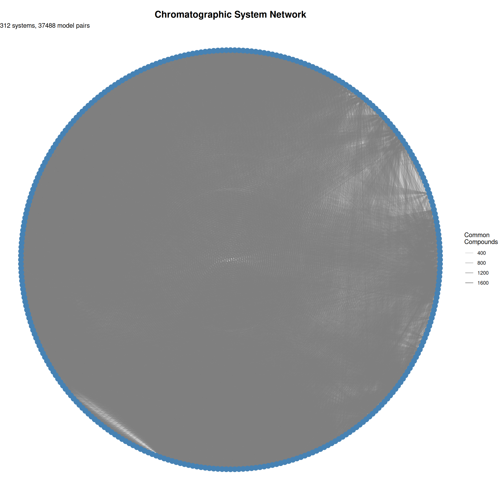
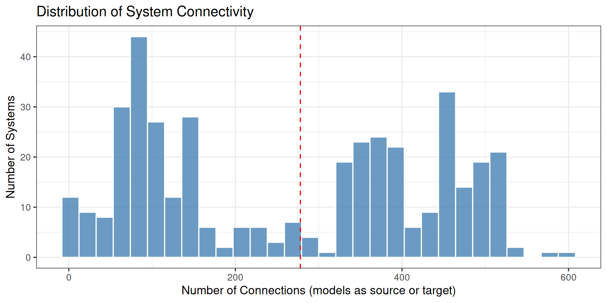
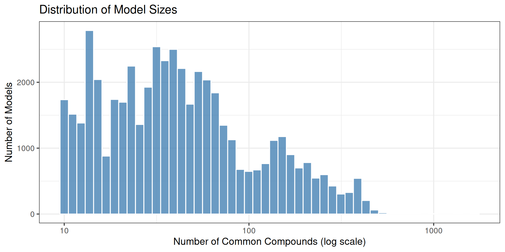
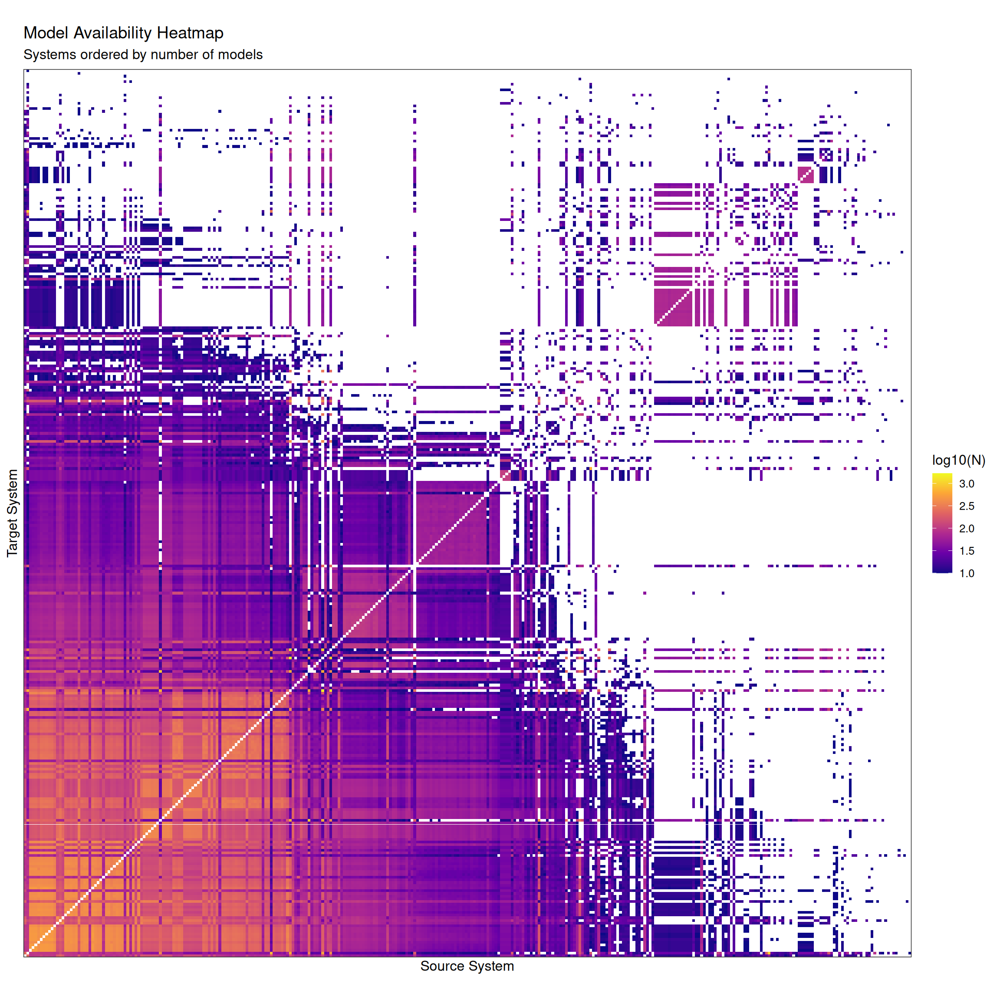

# System Network

## Network Overview

The network shows how chromatographic systems are connected through
pairwise models. Each node is a system and each edge a model between two
systems (models are directional: one per source/target pair).

| Metric                                |  Value |
|:--------------------------------------|-------:|
| Total Systems (Nodes)                 |    328 |
| Total Models (Edges)                  | 49,570 |
| Average Models per System (as source) |  151.1 |
| Network Density                       | 46.22% |

## Network Visualization

## Connectivity Statistics

### Systems with Most Connections

| System | Name                             | Outgoing | Incoming | Total |
|:-------|:---------------------------------|---------:|---------:|------:|
| 0210   | ABC                              |      299 |      299 |   598 |
| 0391   | Brungs_MCE                       |      291 |      291 |   582 |
| 0254   | MSMS_pos_40_ACN_BEH C18          |      265 |      265 |   530 |
| 0256   | MSMS_pos_50_ACN_BEH C18          |      265 |      265 |   530 |
| 0252   | MSMS_pos_30_ACN_BEH C18          |      263 |      263 |   526 |
| 0322   | MSMS_pos_50_MeOH_Raptor Biphenyl |      263 |      263 |   526 |
| 0246   | MSMS_pos_40_ACN_XB-C18           |      262 |      262 |   524 |
| 0236   | MSMS_pos_30_ACN_HSS T3           |      261 |      261 |   522 |
| 0238   | MSMS_pos_40_ACN_HSS T3           |      261 |      261 |   522 |
| 0248   | MSMS_pos_50_ACN_XB-C18           |      260 |      260 |   520 |
| 0244   | MSMS_pos_30_ACN_XB-C18           |      259 |      259 |   518 |
| 0250   | CCS_pos_40_ACN_XB-C18            |      259 |      259 |   518 |
| 0401   | ROASMI_80                        |      259 |      259 |   518 |
| 0392   | UIUC_Carver                      |      258 |      258 |   516 |
| 0400   | ROASMI_79                        |      258 |      258 |   516 |
| 0320   | MSMS_pos_40_MeOH_Raptor Biphenyl |      257 |      257 |   514 |
| 0330   | MSMS_pos_50_ACN_CORTECS C18      |      257 |      257 |   514 |
| 0318   | MSMS_pos_30_MeOH_Raptor Biphenyl |      256 |      256 |   512 |
| 0338   | MSMS_pos_50_MeOH_CORTECS C18     |      255 |      255 |   510 |
| 0350   | MSMS_pos_30_MeOH_HSS C18         |      255 |      255 |   510 |

Top 20 most connected systems

### Connection Distribution

## Models by Compound Count

## Heatmap of System Pairs

