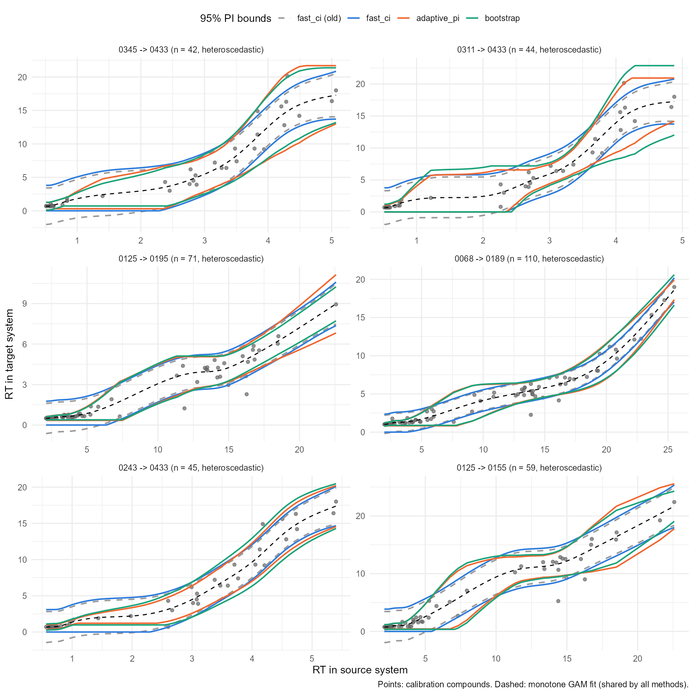
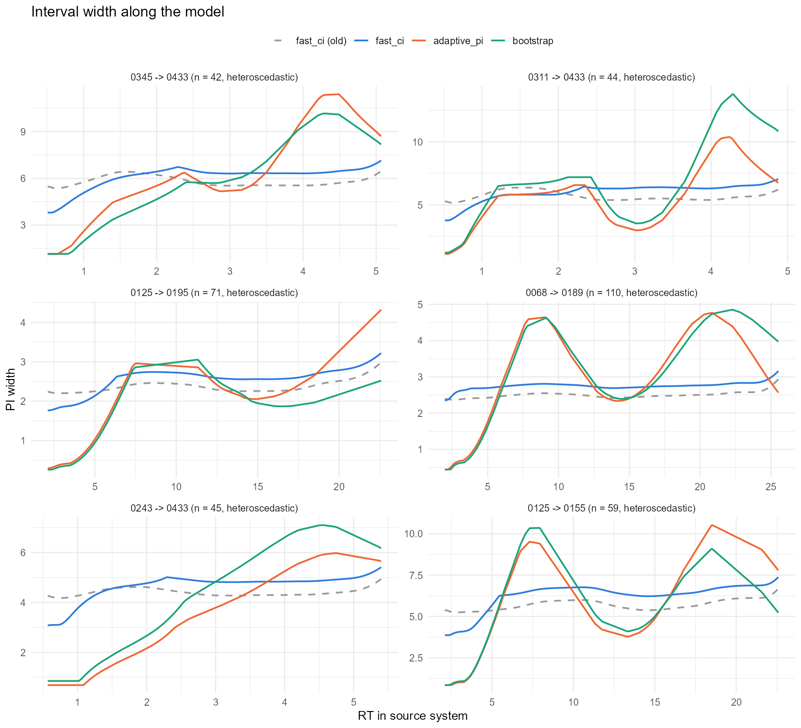
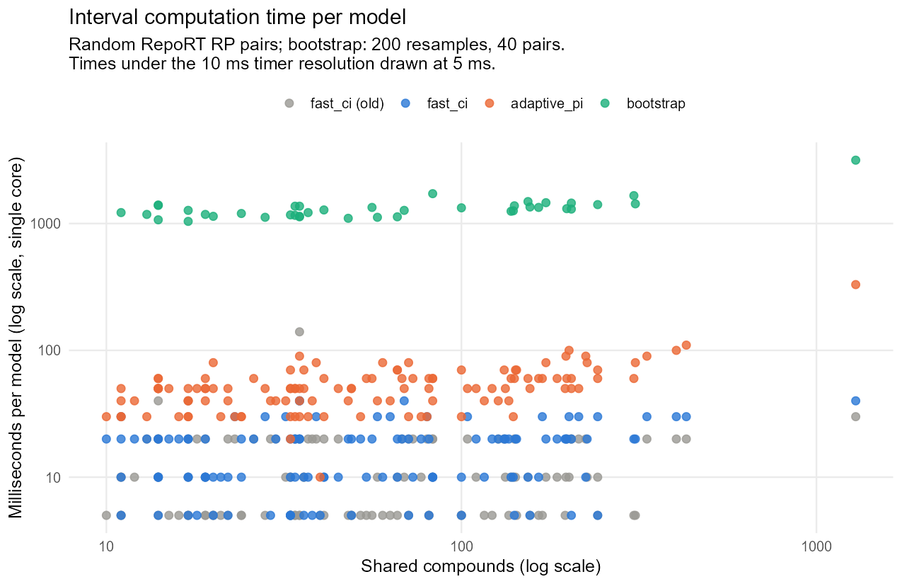

```{r setup}
#| include: false
library(knitr)

summary_tab <- read.csv("benchmark/benchmark_summary.csv", check.names = FALSE)
timing_tab <- read.csv("benchmark/timing_summary.csv", check.names = FALSE)

pct <- function(x) sprintf("%.1f%%", 100 * x)
get <- function(method, column, class = "all") {
  summary_tab[summary_tab$method == method & summary_tab$class == class, column]
}
```

rePredRet offers three ways to compute the 95% prediction interval (PI) around the
monotone GAM (see [Methods](methods.html)):

| Method | Interval width | Calibration |
|---|---|---|
| `adaptive_pi` (default) | follows the local scatter | cross-validated conformal |
| `fast_ci` | nearly constant | normal quantile, leave-one-out residual variance |
| `bootstrap` | follows the local scatter | out-of-bag conformal (200 refits) |

This article compares them with each other, with the versions before they were
fixed, and with the alternatives suggested in an MSc thesis evaluation
(B. Hamidová, 2026): a weighted or MAD residual scale, a heavy-tailed `scat`
likelihood, quantile GAMs (`qgam`) and a location-scale GAM (`gaulss`). That
evaluation found the problems with the earlier methods and gave the idea for
`adaptive_pi`.

## Setup

- **Data**: RepoRT reversed-phase systems. Of the 49,570 ordered pairs with at least 10
  shared compounds, one direction per pair was sampled at random: 40 pairs with 10-15
  compounds, 40 with 30-60 and 30 with 200 or more. Another 25 pairs were chosen for
  clearly unequal scatter along the model: the largest ratio of the median absolute
  residual between thirds of the RT range, among 600 random pairs with R² ≥ 0.8.
- **Coverage**: compounds were held out by cross-validation (leave-one-out up to 30
  compounds, 10-fold up to 100, 5-fold above). A held-out compound is covered if its
  measured RT lies inside the PI of the model built without it.
- **Quiet / noisy**: each compound is labelled by the scatter of its neighbours along
  the source RT, split at the pair's median. An interval whose width follows the
  scatter covers about 95% in both.
- **Interval score**: width + (2 / 0.05) × distance outside the interval, divided by
  the target RT range (median over pairs; lower is better). It rewards coverage and
  narrow intervals together.
- **Width ratio**: 95th / 5th percentile of the width along the model (1 = constant).
- **Failures**: fits that errored or gave non-finite bounds. **Absurd**: median width
  larger than the target RT range.

The script is `inst/benchmark/pi_benchmark.R`.

## Results

```{r overall}
#| echo: false
cols <- c(Method = "method", Coverage = "coverage", Quiet = "cov_quiet", Noisy = "cov_noisy",
          `Interval score` = "med_iscore", `Median width / range` = "med_width_rel",
          `Width ratio` = "width_ratio_q95q05", Failures = "fail_fits", Absurd = "absurd")
order <- c("adaptive_pi", "fast_ci", "bootstrap", "fast_ci (before fix)", "bootstrap (before fix)",
           "weighted sigma", "MAD sigma", "scat", "qgam", "gaulss")
tab <- summary_tab[summary_tab$class == "all", ]
tab <- tab[match(order, tab$method), cols]
names(tab) <- names(cols)
kable(tab, digits = 3, row.names = FALSE, caption = "All 135 pairs (95% nominal coverage)")
```

```{r by-size}
#| echo: false
classes <- c("small (10-15)", "mid (30-60)", "large (200+)", "heteroscedastic")
by_size <- sapply(classes, function(cl) {
  vapply(order, function(m) get(m, "coverage", cl), numeric(1))
})
by_size <- data.frame(Method = order, by_size, check.names = FALSE, row.names = NULL)
het_noisy <- vapply(order, function(m) get(m, "cov_noisy", "heteroscedastic"), numeric(1))
by_size$`heteroscedastic, noisy regions` <- het_noisy
kable(by_size, digits = 3, caption = "Coverage by group")
```

- **`adaptive_pi`** covers `r pct(get("adaptive_pi", "coverage"))` overall, and about the
  same in quiet and noisy regions (`r pct(get("adaptive_pi", "cov_quiet"))` /
  `r pct(get("adaptive_pi", "cov_noisy"))`). Its width varies along the model
  (median ratio `r round(get("adaptive_pi", "width_ratio_q95q05"), 1)`).
- **`fast_ci`** covers `r pct(get("fast_ci", "coverage"))`, but too much in quiet regions
  and too little in noisy ones (`r pct(get("fast_ci", "cov_quiet"))` /
  `r pct(get("fast_ci", "cov_noisy"))`). In pairs with unequal scatter it covered
  `r pct(get("fast_ci", "cov_noisy", "heteroscedastic"))` in the noisy regions.
  Before the fix (in-sample residual variance and running-maximum bounds) it covered
  `r pct(get("fast_ci (before fix)", "coverage"))` overall and
  `r pct(get("fast_ci (before fix)", "coverage", "small (10-15)"))` with 10-15 compounds.
- **`bootstrap`** behaves like `adaptive_pi` (`r pct(get("bootstrap", "coverage"))`
  coverage) at 25-50 times the cost. Before the fix it was a confidence interval of
  the curve rather than a prediction interval
  (`r pct(get("bootstrap (before fix)", "coverage"))` coverage).
- A **weighted** or **MAD** residual scale makes the interval narrower but undercovers,
  most of all in noisy regions. Outliers are part of the data the interval must cover;
  a robust scale only helps together with an empirical calibration.
- **`scat`** keeps a constant width and undercovers. **`qgam`** covers well from 30
  compounds up but failed `r get("qgam", "fail_fits")` fits, mostly with 10-15 compounds,
  and takes about 1.3 s per model. **`gaulss`** adapts the width but is unstable with few
  compounds (`r get("gaulss", "fail_fits")` failures, very large width ratios).

### Few compounds

With 10-15 shared compounds no method reaches 95%: `adaptive_pi` covered
`r pct(get("adaptive_pi", "coverage", "small (10-15)"))`, `fast_ci`
`r pct(get("fast_ci", "coverage", "small (10-15)"))` and `bootstrap`
`r pct(get("bootstrap", "coverage", "small (10-15)"))`. Treat the intervals of models
with fewer than about 20 compounds as roughly 85-90% intervals.

## Examples

The bands of the three methods, and of `fast_ci` before the fix, on pairs with unequal
scatter. `adaptive_pi` and `bootstrap` are narrow where the compounds agree, often in
the early-eluting cluster, and wide where they scatter. Where the raw bound would
decrease, the monotone bound is flat.





Pairs of different sizes:


## Speed

Single-core time to compute the interval, including the monotone fit, on 120 random
pairs (bootstrap: 40 pairs). The last two columns extrapolate to the about 50,000
models of the full pipeline.

```{r timing}
#| echo: false
names(timing_tab) <- c("Method", "Models", "Mean ms", "Median ms", "Max ms",
                       "Hours, 50k models, 1 core", "Hours, 50k models, 4 cores")
kable(timing_tab[match(c("adaptive_pi", "fast_ci", "bootstrap", "fast_ci (old)"), timing_tab$Method), ],
      row.names = FALSE)
```



Most of the time of `adaptive_pi` is the scale model (a Gamma GAM). Its five
cross-validation refits are cheap because they reuse the smoothing parameter of the
full fit.

## Conclusion

`adaptive_pi` is the default: it is calibrated in quiet and noisy regions and costs
about 50-90 ms per model. Use `fast_ci` when speed matters more than an interval that
follows the local scatter.
